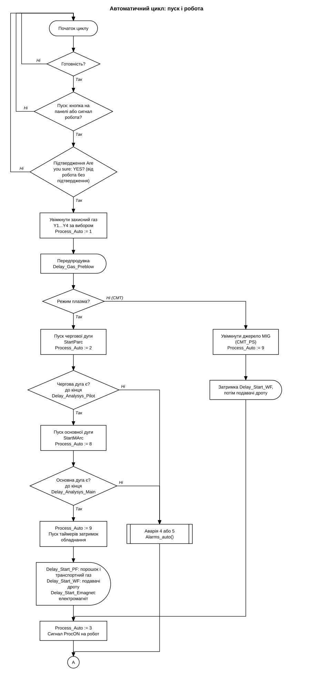
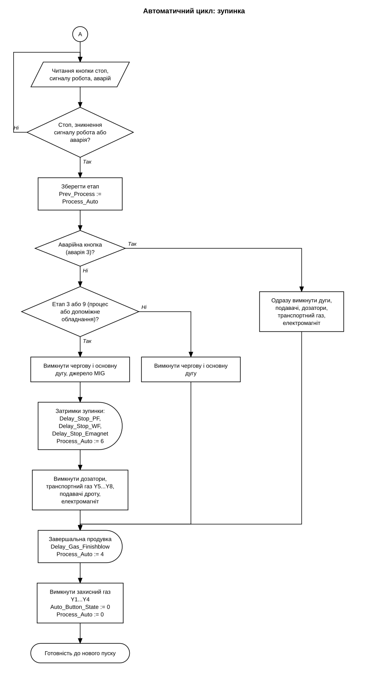

# 3D_Printing_Titan

Програма ПЛК і панелі оператора для установки адитивного наплавлення металу (3D-друку) плазмовою дугою з подачею порошку і дроту. Пальник переміщує робот. ПЛК керує газовою системою, черговою і основною дугою, дозаторами порошку, подавачами дроту, електромагнітом і джерелом MIG (CMT), вимірює напругу дуги для робота та обмінюється з ним сигналами.

## Обладнання і ПЗ

- ПЛК: Schneider Modicon TM241CE24T
- Модулі вводу-виводу: TM3DQ8T (транзисторні виходи), TM3DQ16R (релейні виходи), 2x TM3AQ4 (аналогові виходи), TM3AM6 (аналогові входи і виходи), TM3TI4 (аналогові входи)
- Панель оператора: Kinco GL100E у виносному пульті разом з відеомонітором і аварійною кнопкою, зв'язок з ПЛК по RS485 (Modbus RTU)
- Джерело струму плазми: AOTAI 630 з плазмовим модулем DC/AC, уставка струму 4...20 мА, пуск і сигнали дуги реле
- Джерело MIG (CMT): пуск реле, зміна струму імпульсами "+" і "-"
- Дозатори порошку: 4 шт., швидкість 4...20 мА, пуск реле
- Подавачі дроту: 3 шт., драйвери постійного струму з уставкою 4...20 мА, напрямок реле, енкодер на кожному
- Електромагніт: драйвер з ШІМ, два напрямки
- Газ: 4 клапани захисного газу і 4 клапани транспортного газу
- Робот: AIR50, програми `.arl`, зв'язок по RS485 (Modbus RTU) і дискретними сигналами
- SoMachine Logic Builder V4.3, мова Structured Text
- Kinco DTools для панелі

## Режими

Ручний режим призначений для налагодження: кожен вихід вмикається окремою кнопкою на панелі. Автоматичний режим виконує цикл пуску і зупинки з таймерами, які задаються на панелі.

В автоматичному режимі вибирається технологічне джерело: плазма або CMT (MIG). Окремо вибираються канали захисного газу 1...4, дозатори порошку 1...4, подавачі дроту 1...3 і електромагніт. Пуск можливий з панелі (з вікном підтвердження "Are you sure") або сигналом робота.

Режим вибирається словом `MW0.0`: 1 автоматичний, 0 ручний.

## Структура програми

Усе викликається з `Main`:

```
Measure();
Wire_Speed_Correction();
RTRIG1(CLK:= TRUE);                                    // перший цикл
IF RTRIG1.Q THEN PrevCurrentCMT_HMI:= SetCurrentCMT_HMI; END_IF
IF MW0.0 THEN Auto(); Alarms_auto(); ELSE Manual(); Alarms_manual(); END_IF
```

| Програма | Що робить |
|---|---|
| `Main` | викликає решту програм, один раз запам'ятовує уставку струму CMT |
| `Auto` | автоматичний цикл: пуск, робота, зупинка, затримки обладнання |
| `Manual` | пряме керування виходами з панелі, електромагніт, подавачі дроту, струм CMT |
| `Alarms_auto` | аварії в автоматичному режимі, аварійна зупинка |
| `Alarms_manual` | аварії в ручному режимі |
| `Measure` | вхідні сигнали для панелі, ознака чергової дуги, частоти енкодерів по HSC |
| `Wire_Speed_Correction` | підтримання швидкості подавачів дроту за частотою енкодера |
| `AVC` | усереднення напруги дуги для робота |
| `GVL` | глобальні змінні: входи, виходи, регістри обміну з панеллю |

## Автоматичний цикл

Стан циклу записується в `Process_Auto` і виводиться на панель:

| Значення | Стан |
|---|---|
| 0 | готовність, очікування пуску |
| 1 | передпродувка |
| 2 | очікування чергової дуги |
| 8 | очікування основної дуги |
| 9 | очікування затримок допоміжного обладнання |
| 3 | процес |
| 6 | затримки зупинки |
| 4 | завершальна продувка |
| 5 | не готовий |
| 10, 11 | аварія (значення чергуються, панель блимає) |

Готовність (`MW6.11`) вимагає вибраного джерела (плазма або CMT), хоча б одного каналу захисного газу, відпущеної аварійної кнопки і відсутності аварії. Для пуску від робота додатково потрібен сигнал готовності робота.

Усі затримки зберігаються в регістрах RETAIN і задаються на панелі:

| Затримка | Регістр | Призначення |
|---|---|---|
| `Delay_Gas_Preblow` | MW74 | передпродувка перед запалюванням |
| `Delay_Analysys_Pilot` | MW94 | очікування чергової дуги, аварія 4 (одиниці по 10 мс) |
| `Delay_Analysys_Main` | MW96 | очікування основної дуги, аварія 5 (одиниці по 10 мс) |
| `Delay_Start_PF` | MW82 | пуск дозаторів порошку і транспортного газу після появи основної дуги |
| `Delay_Start_WF` | MW84 | пуск подавачів дроту після появи основної дуги |
| `Delay_Start_Emagnet` | MW86 | пуск електромагніту після появи основної дуги |
| `Delay_Stop_PF` | MW88 | вимкнення дозаторів і транспортного газу після зупинки |
| `Delay_Stop_WF` | MW90 | вимкнення подавачів дроту після зупинки |
| `Delay_Stop_Emagnet` | MW92 | вимкнення електромагніту після зупинки |
| `Delay_Gas_Finishblow` | MW76 | завершальна продувка (одиниці по 10 мс) |
| `Check_Voltage_Current_Delay` | MW42 | початок перевірки напруги і струму після виходу на процес |
| `Emergency_Delay` | MW44 | від появи аварії до зупинки |

Затримки пуску й зупинки запускаються паралельно, тому порядок вмикання дозаторів, подавачів і електромагніту залежить від значень, заданих на панелі.

Зупинка залежить від етапу, на якому її виявлено. До виходу на процес вимикаються лише дуги і виконується завершальна продувка. З процесу спочатку вимикаються дуги і джерело MIG, далі обладнання вимикається по своїх затримках, потім іде продувка. Аварійна кнопка вимикає всі виконавчі пристрої одразу, продувка виконується в кінці.

Струм CMT змінюється імпульсами реле "+" і "-": кожен імпульс змінює значення на одну одиницю, поточна уставка рахується в `PrevCurrentCMT_HMI`.

Електромагніт працює від програмного ШІМ: напрямки `EM_R_PWM` і `EM_L_PWM` чергуються з півперіодом, обчисленим із частоти, заданої на панелі. Для вимірювання часу використовується `SysTimeGetUs`.

## Алгоритм





Порядок вмикання допоміжного обладнання на блок-схемі показано блоком "затримки", бо таймери стартують одночасно.

## Швидкість подавачів дроту

`Wire_Speed_Correction` порівнює задану швидкість з частотою енкодера (лічильники HSC) і підстроює аналогову уставку драйвера: кожні 100 мс уставка змінюється кроком у бік заданої частоти, поки різниця більша за допуск. Уставка обмежується діапазоном вихідного каналу. Корекція виконується для подавача, що увімкнений у ручному режимі, і для подавача, увімкненого в автоматичному режимі на етапі процесу.

## Напруга дуги і робот

`AVC` усереднює напругу джерела, поки робот тримає сигнал "вимір". На фронті 0 -> 1 накопичення починається, на фронті 1 -> 0 результат записується в слово `QW13` (значення в сотих частках вольта). Відліки поза допустимим діапазоном і різкі стрибки відносно відфільтрованого значення відкидаються, решта згладжується експоненціальним фільтром, середнє рахується за відфільтрованими значеннями. Якщо команда відсутня довше 5 с, у `QW13` записується нуль, щоб робот не отримав застаріле значення.

Робот читає це слово і коригує координату Z за відхиленням від середньої напруги, тобто виконує автоматичне регулювання напруги дуги (АРНД).

Команда "вимір" може надходити двома способами:

| Версія | Джерело команди | Файл |
|---|---|---|
| основна | дискретний вхід `IX0.7` | `src/AVC.st`, `src/GVL.st` |
| RS485 | біт 0 слова `IW19` по Modbus, з підтвердженням нуля 50 мс | `src/variants/AVC_RS485.st` |

Решта програми в обох версіях однакова.

Програми робота:

| Файл | Що робить |
|---|---|
| `robot/Snake_AVC_RS485.arl` | прохід лініями ("змійкою") з кроком по Y, вимір напруги в зоні посередині лінії, корекція Z |
| `robot/Flange_AVC_RS485.arl` | наплавлення шарів на деталі типу фланця з обертанням зовнішньої осі, підйом на висоту шару, корекція Z за напругою |

Обидві програми написані під варіант RS485: вимір запускається і зупиняється записом по Modbus RTU (функції `AVCON`, `AVCOFF`), результат читається функцією `AVCREAD`. У основній версії команду виміру подає дискретний вихід робота на `IX0.7`, результат читається так само. Поправка Z береться лише для напруги в допустимому діапазоні і обмежується мінімальною координатою.

## Сигнали робота

| Сигнал | Адреса | Напрямок | Значення |
|---|---|---|---|
| `ProcON` | `%QX0.7` | на робот | процес іде |
| `PArcON` | `%QX0.6` | на робот | чергова дуга є |
| `StartExt` | `%IX1.0` | від робота | пуск |
| `ReadyExt` | `%IX1.1` | від робота | робот готовий (сигнал має змінюватися частіше ніж раз на 150 мс) |
| `IX07` | `%IX0.7` | від робота | команда "вимір" напруги дуги |
| `QW13` | `%QW13` | на робот | усереднена напруга, сотих частки вольта |
| `EmergencyExt` | `%IX1.2` | від виносного пульта | аварійна кнопка (0 В) |

## Аварії

Код активної аварії записується в `Alarms` (`MW104`), прапорець аварії автоматичного режиму `MW6.10`, ручного `MW0.7`. Перевірка напруги і струму вмикається прапорцями з панелі (`MW4.0`, `MW4.1`) і починається із затримкою після виходу на процес.

| Код | Аварія |
|---|---|
| 1 | напруга джерела нижче уставки |
| 2 | струм джерела нижче уставки |
| 3 | аварійна кнопка |
| 4 | немає чергової дуги за час `Delay_Analysys_Pilot` |
| 5 | немає основної дуги за час `Delay_Analysys_Main` |
| 6 | робот не готовий під час пуску від робота |

## Ручний режим

Виходи вмикаються з панелі словами `MW0` (клапани Y1...Y8) і `MW2` (дуги, електромагніт, подавачі дроту з напрямком, дозатори, CMT). Швидкості дозаторів і подавачів задаються окремими регістрами ручного режиму. Якщо увімкнений хоча б один виконавчий пристрій, автоматичний режим блокується (`MW6.14`).

## Репозиторій

```
PLC/PLC.project    проєкт SoMachine
HMI/               проєкт Kinco DTools
src/               тексти програм, по файлу на програму
robot/             програми робота
docs/              електросхеми, таблиці, блок-схеми
```

Файли в `src/` призначені для читання, проєкт збирається з `PLC/PLC.project`.

Документація:

- `docs/schematic/sheet-01.jpg ... sheet-10.jpg`: електросхеми шафи керування (живлення, ПЛК, виходи, аналогові виходи, подавачі дроту, клапани, джерело струму, керування джерелом, аналогові входи, панель).
- `docs/schematic/remote-control.jpg`: виносний пульт.
- `docs/schematic/wire-feeder.jpg`: подавач дроту (двигун і енкодер).
- `docs/schematic/connection-1.jpg ... connection-4.jpg`: схеми з'єднань джерела струму, плазмового модуля, блока чергової дуги, пульта і силових кабелів.
- `docs/schematic/pneumatic-1.jpg`, `docs/schematic/pneumatic-2.jpg`: пневмосхема захисного і транспортного газу.
- `docs/io-table.xlsx`: таблиця входів і виходів.
- `docs/variable-map.xlsx`: карта адрес панелі і ПЛК, окремо біти обміну.
- `docs/bom.xlsx`: перелік елементів.
- `docs/algorithm-start.svg`, `docs/algorithm-stop.svg`: блок-схеми алгоритму.

Адреси: `%4X` у панелі і `%MW` у ПЛК означають одне й те саме слово, номер у панелі на одиницю більший.

## Історія

- 04.2025: схеми доповнені джерелом MIG (CMT), подавачем дроту і пультом.
- 06.05.2026: програма робота зі змійкою і вимірюванням напруги по Modbus.
- 07.05.2026: проєкт панелі оператора.
- 11.05.2026: версія ПЛК з командою "вимір" по RS485, програма робота для фланця.
- 13.05.2026: версія ПЛК з командою "вимір" по дискретному входу.

## Як відкрити проєкт

- ПЛК: SoMachine V4.3, відкрити `PLC/PLC.project`.
- Панель: Kinco DTools, відкрити `HMI/Plasma_17_56.dpj`. Модель панелі GL100E.
- Перед завантаженням в контролер перевірити налаштування послідовних портів (панель і робот) на реальній машині.
